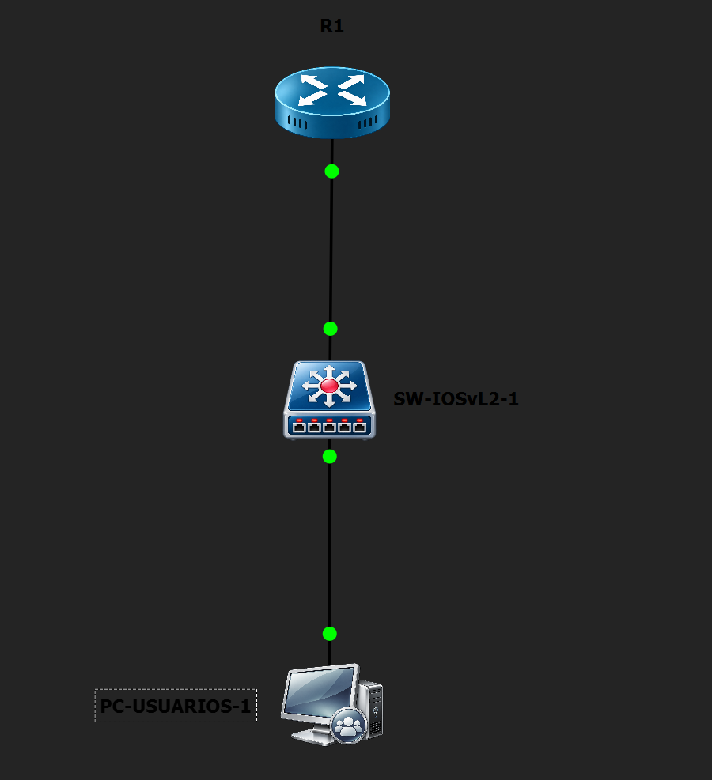
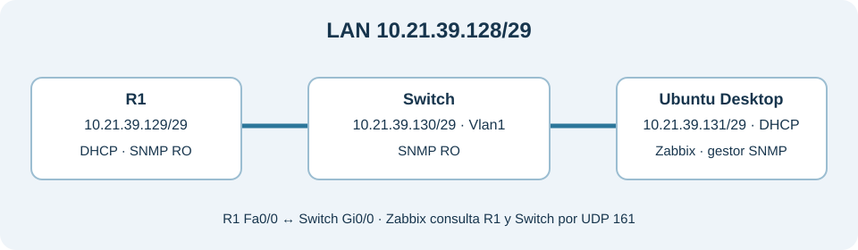
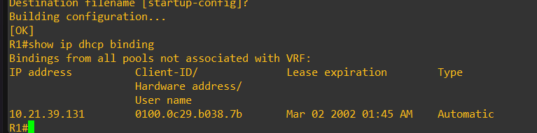
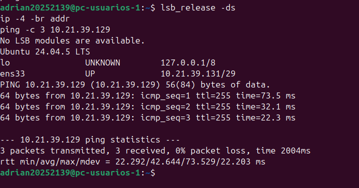
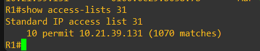
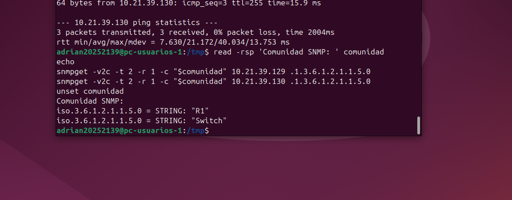
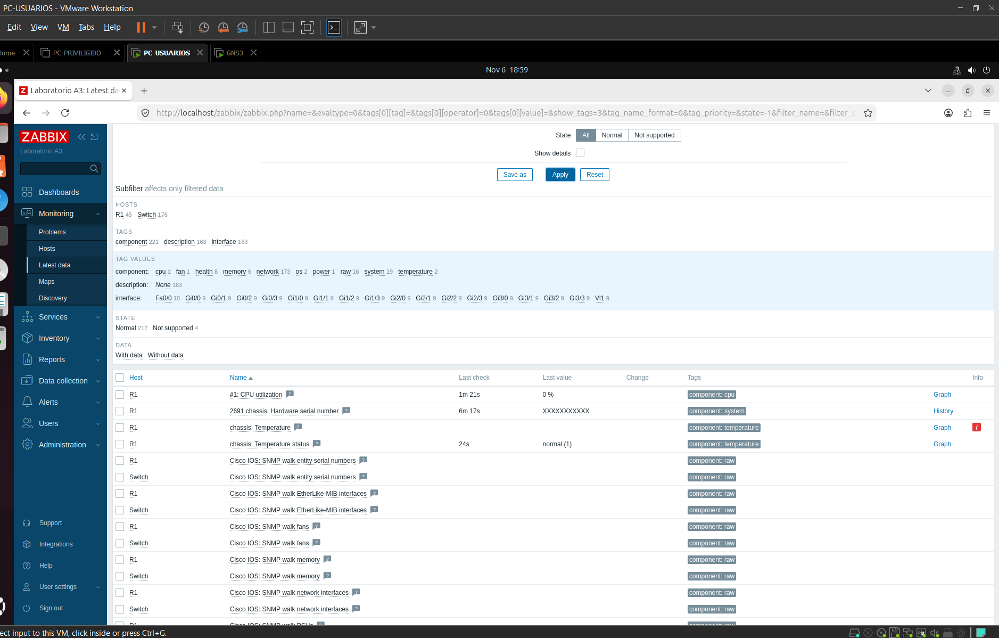
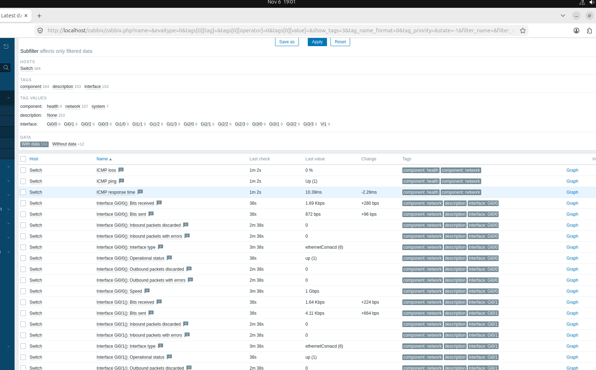
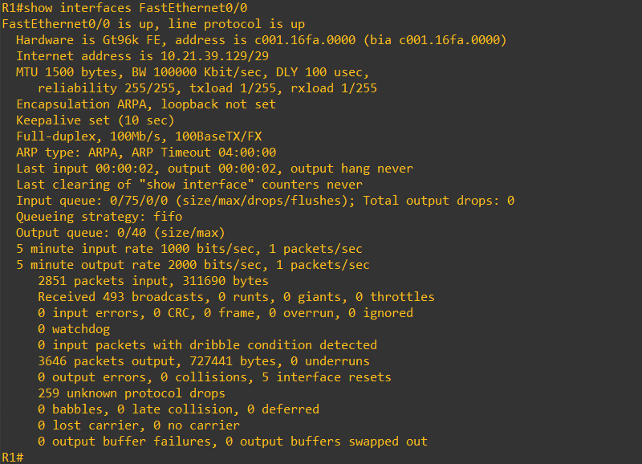
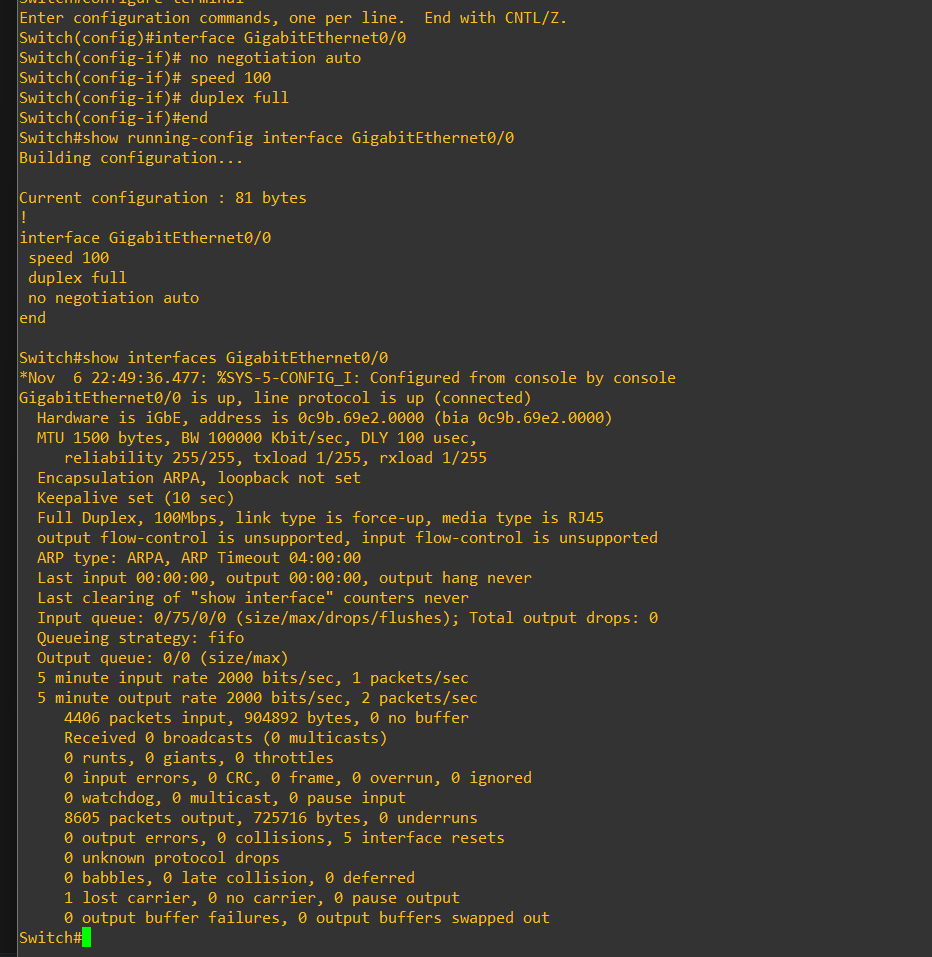

## Video demostrativo

[▶ Ver la demostración del laboratorio A3 en YouTube](https://youtu.be/YAdXeqfQIGc)

# Laboratorio A3 · DHCP y monitoreo SNMP con Zabbix

**Autor** Adrian Magallanes · **Matrícula** 2025-2139 · **Entorno** GNS3, Ubuntu Desktop 24.04.5 LTS y Zabbix 7.0

## Propósito del laboratorio

Configurar una LAN en la que R1 entregue por DHCP la dirección de Ubuntu Desktop y Zabbix consulte el estado del router y de un switch multicapa. Las consultas usan SNMPv2c con una comunidad de solo lectura. Una lista de acceso permite el sondeo únicamente desde la IP que recibe Ubuntu.

El resultado esperado es observar en Zabbix valores recientes de ambos equipos, además de demostrar el origen de la IP del servidor y la restricción aplicada a SNMP.

## Topología y direccionamiento

La topología operativa conecta R1 con Switch y Ubuntu Desktop con Switch. En GNS3, la máquina Ubuntu aparece como **PC-USUARIOS-1**.





| Equipo e interfaz | Dirección | Función |
|---|---|---|
| R1 Fa0/0 · Cisco c7200 | 10.21.39.129/29 | Puerta de enlace, servidor DHCP y agente SNMP |
| Switch Vlan1 · Cisco IOSvL2 multicapa | 10.21.39.130/29 | Dirección de gestión y agente SNMP |
| Ubuntu Desktop ens33 · PC-USUARIOS-1 | 10.21.39.131/29 por DHCP | Servidor Zabbix y gestor SNMP |

La red **10.21.39.128/29** utiliza los octetos 21 y 39 de la matrícula. Su máscara es **255.255.255.248**. R1 Fa0/0 se conecta con Switch Gi0/0. El enlace quedó a **100 Mb/s y full-duplex** en ambos extremos. Ubuntu llega a R1 y Switch por la misma LAN.

## Configuración aplicada

### DHCP en R1

R1 excluye 10.21.39.129–130 y 10.21.39.132–134. Así deja disponible 10.21.39.131 para el cliente Ubuntu. El pool LAN-ZABBIX anuncia la red 10.21.39.128/29 y la puerta de enlace 10.21.39.129. La concesión se comprobó con show ip dhcp binding en R1 y con ip -4 -br addr en Ubuntu.





### SNMP y lista de acceso

R1 y Switch usan una comunidad SNMP con permiso **RO** y la ACL **31**. La ACL permite la dirección 10.21.39.131 de Ubuntu. La comunidad real se reemplazó por un marcador en los archivos públicos. El siguiente fragmento representa la configuración sin revelar ese valor.

```text
access-list 31 permit 10.21.39.131
snmp-server community <COMUNIDAD_SNMP_OCULTA> RO 31
```

La ACL de R1 registró consultas coincidentes desde la IP permitida. La configuración de Switch contiene la misma regla. La prueba de rechazo desde otra IP no se realizó y queda indicada como pendiente.



Desde Ubuntu se consultó el OID **.1.3.6.1.2.1.1.5.0**, correspondiente a sysName.0. Las respuestas identificaron a **R1** y **Switch**.



### Servidor Zabbix

Zabbix 7.0 se instaló en Ubuntu Desktop 24.04.5 LTS con MySQL y Apache. Para descargar los paquetes, Ubuntu se conectó temporalmente a una red NAT y luego volvió a la LAN de GNS3. El cliente DHCP recuperó 10.21.39.131/29. El frontend se abrió en **http://localhost/zabbix**.

Se crearon dos hosts habilitados y supervisados por el servidor Zabbix.

| Host en Zabbix | Interfaz SNMP | Plantilla |
|---|---|---|
| R1 | 10.21.39.129, UDP 161, SNMPv2c | Cisco IOS by SNMP |
| Switch | 10.21.39.130, UDP 161, SNMPv2c | Cisco IOS by SNMP |

En cada host, la macro **{$SNMP_COMMUNITY}** contiene la comunidad configurada en los equipos Cisco. Su valor se guardó como texto secreto.

## Resultados observados

En **Monitoring → Latest data**, R1 mostró valores recientes de uso de CPU y estado de temperatura. Switch mostró estado operativo **up** y tráfico en Gi0/0, junto con métricas de otras interfaces. Estas pantallas confirman que Zabbix recibió datos de ambos agentes.





Después de corregir el enlace R1–Switch, las dos interfaces mostraron **100 Mb/s y full-duplex**.





## Archivos del repositorio

- [Procedimiento de implementación y verificación](docs/VERIFICACION.md)
- [Comandos IOS de R1 y Switch](scripts/README.md)
- [Running-configs con comunidad oculta](configs/README.md)
- [Índice de capturas](evidencias/README.md)
- [TXT de entrega A3](AdrianMagallanes_2025-2139_A3.txt)

Los running-configs corresponden al estado final de los equipos. Solo se sustituyó el valor de la comunidad SNMP en las copias publicadas.

## Entrega individual

El video de YouTube debe durar **como máximo 10 minutos** y mostrar la fecha, la hora, el rostro y la voz del autor. La demostración debe centrarse en la topología, el DHCP, la configuración SNMP de solo lectura y los datos recientes de R1 y Switch en Zabbix. Su enlace figura al inicio de este README y en el TXT de entrega.

## Referencias

- [Zabbix · Monitorizar un switch o router](https://www.zabbix.com/documentation/current/en/manual/guides/monitor_switch)
- [Cisco · Comunidad SNMP de solo lectura y ACL](https://www.cisco.com/c/en/us/support/docs/ip/access-lists/13608-21.html)

