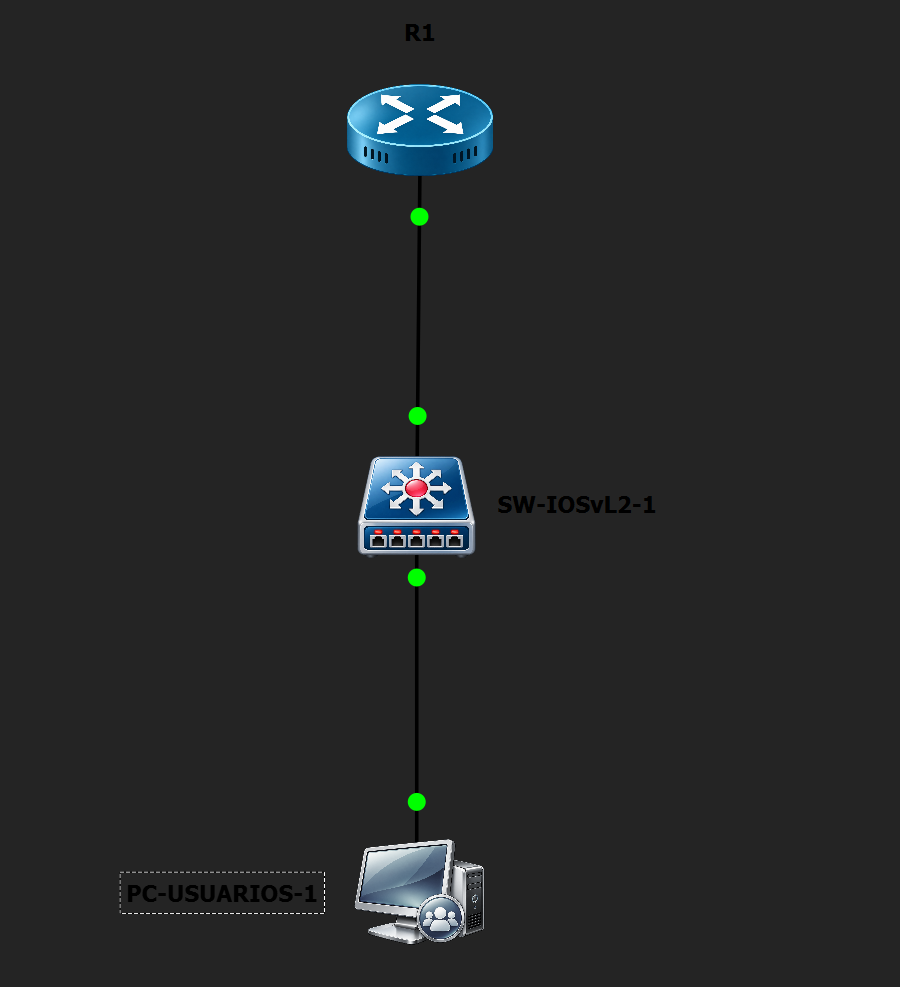
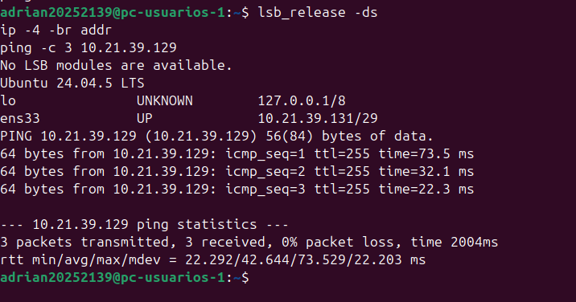
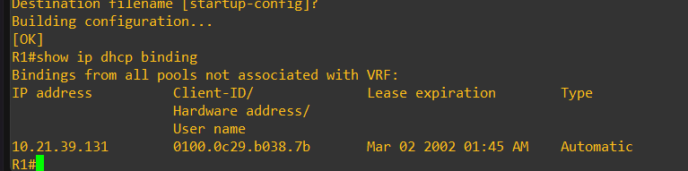
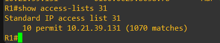
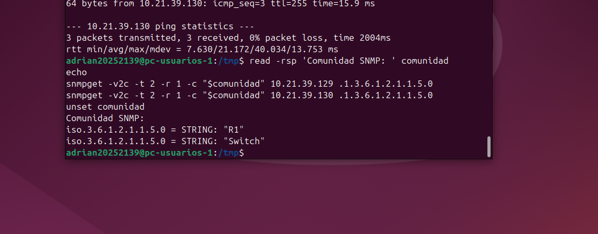
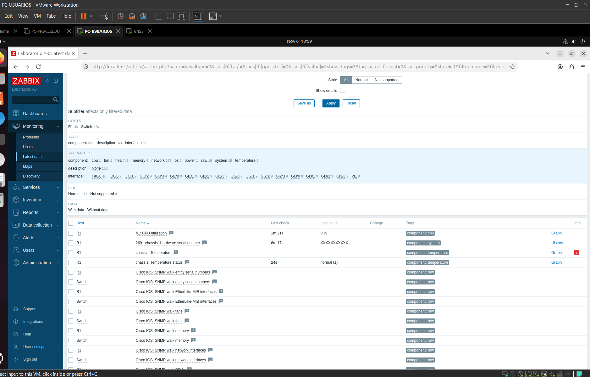
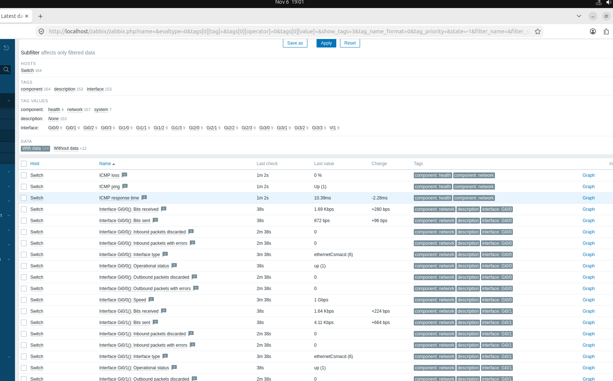
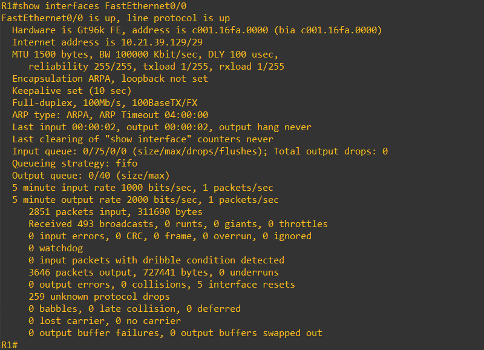
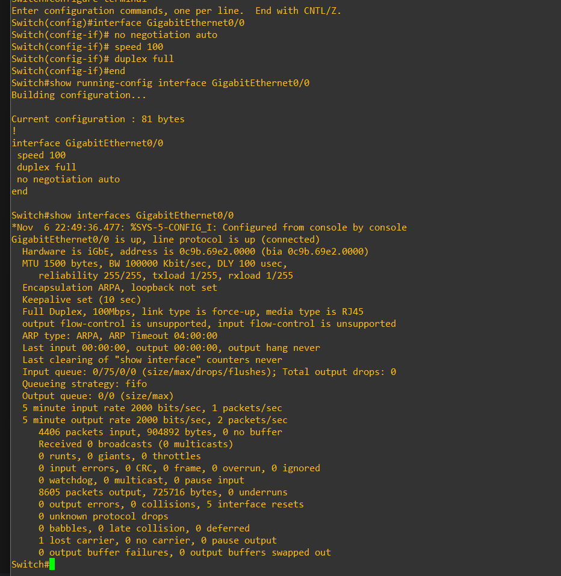

# Evidencias del laboratorio A3

## Topología y direccionamiento

El proyecto GNS3 conecta R1 con Switch y Ubuntu Desktop con el switch.

Ubuntu recibió 10.21.39.131/29 y respondió al ping de R1. R1 registró la concesión DHCP.

## SNMP y control de acceso

La ACL 31 de R1 permite consultas desde 10.21.39.131. La configuración final del switch contiene la misma ACL. Las consultas SNMPv2c desde Ubuntu devolvieron R1 y Switch.

## Hosts y datos en Zabbix

Ambos hosts tienen una interfaz SNMPv2 en UDP 161 y la plantilla Cisco IOS by SNMP. La comunidad se asignó mediante una macro cuyo valor se ocultó en Zabbix.

Latest data mostró valores recientes de los dos equipos. En Switch se observó tráfico y el estado operativo de Gi0/0.

## Enlace entre R1 y Switch

Las dos interfaces quedaron activas a 100 Mb/s y full-duplex.

La prueba SNMP desde otra IP no se realizó. La comunidad y la contraseña de MySQL no aparecen en estas capturas.

